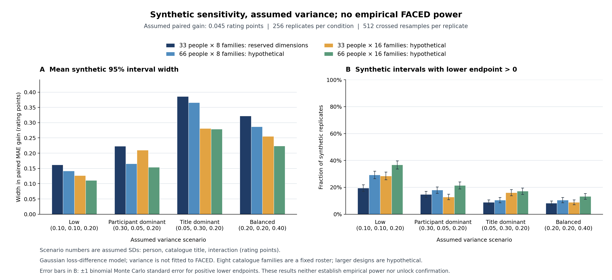

# Claim selection and inactive confirmation freeze

12 October 2026. **The requested preparation is complete: the development diagnosis and bounded baseline qualification are audited, a defensible current claim is selected for review, and the candidate confirmation protocol is frozen but inactive.** No protected EEG or rating value, final source fit, manuscript edit or research-question adoption occurred in this preparation.

## Selected scientific claim

In the reused FACED development panels, source-selected category medians are competitive with the two tested late-interval EEG predictors, and their gains and person/film pairing effects are inconsistent or uncertain. Category support changes contextual comparator qualification.

The claim is an exploratory case-study finding. It does not establish noninferiority, equivalence, absence of EEG information, a causal affective mechanism or a new architecture. The previous mean gains of 0.0446 and 0.0052 MAE remain development summaries of dependent rotations. No independently confirmed EEG advantage has been added.

## Frozen prospective comparison

The primary question concerns the **whole spectral-plus-context prediction recipe** relative to source category medians. These predictors differ in metadata inputs and predictor form as well as EEG. A mandatory secondary matched-context Ridge comparison therefore uses the same 13 contextual columns, source rows, alpha 100 and scaling rule as joint Ridge. Improvements in the primary contrast alone cannot be attributed specifically to EEG.

The proposed final source rectangle is 70 clean source people × 14 development titles = 980 trials. The 20 validation participants remain development only. Protected primary scope is 33 people × eight catalogue title families/nine clips = 297 trials; familiar secondary scope 462 trials. Catalogue title separation is verified; original-footage independence remains unverified. Fear and Inspiration each have one development title, limiting material-transfer qualification even after combining the 14 development titles.

The metric averages **clip-level absolute errors within person/title**, then titles and people equally. This prevents clips 7/8 of one title from receiving extra family weight. On unavailable EEG, joint and matched-context predictors both retain source-category fallback. All outcomes remain in the denominator; matched gain is zero on those failures.

The contract freezes source identities, metadata, late 32-second native interval / 28-second core, existing artifact/QC rules, Ridge recipes, scoring, 4,000 descriptive crossed resamples, budgets and failure rules. It requires separate signal and rating phases: protected predictions for all three methods must be locked to exact identities, file hashes, final states and prediction-only value digests before any protected rating conversion. Changed predictions, missing trials and role/arm mismatches are rejected before reading target values.

**41 synthetic/metadata safeguard tests passed**, including complete denominators, loss-before-family averaging, shared failure fallback, inactive access rejection and tampered predictions rejected before target conversion. An independent reviewer rehashed all 51 current and 42 prior evidence bindings and verified the original report hash.

This is a guarded information/analysis contract, **not an implemented end-to-end source-fit or protected-data inference backend**. Actual final source state/scaler/prior artifacts, exact export-bytes-to-projection qualification and protected extraction must be implemented and independently qualified before any later execution. No such execution is activated here.

## Synthetic precision study

The study was frozen in Git `a70f71553` before execution. It generated 4,096 synthetic crossed person/title matrices and 2,097,152 bootstrap means, reporting 48 conditions. Runtime was 5.81 wall seconds and 2.03 CPU seconds. Eight fixture tests are included in the 41 above. Aggregate verification and an independent numerical audit passed.

The matrices use analyst-assumed independent Gaussian person/title/interaction effects in paired loss differences. No empirical variance is calibrated. The 0.045 scenario was supplied from published development summaries; this is not a blinded study. Gaussian unboundedness, omitted model-selection/training uncertainty, fixed catalogue sampling and finite Monte Carlo resolution limit interpretation. Simulated coverage and positive intervals are **not empirical FACED power**.

For the reserved 33-by-eight dimensions, each scenario uses 256 simulated matrices:

| Assumed variance scenario | Mean synthetic interval width | Synthetic coverage | Positive lower bound if gain=0.045 | If gain=0.15 |
|---|---:|---:|---:|---:|
| Low | 0.1619 | 239/256 (93.36%) | 50/256 (19.53%) | 237/256 (92.58%) |
| Participant dominant | 0.2233 | 243/256 (94.92%) | 38/256 (14.84%) | 192/256 (75.00%) |
| Title dominant | 0.3864 | 234/256 (91.41%) | 23/256 (8.98%) | 81/256 (31.64%) |
| Balanced | 0.3220 | 246/256 (96.09%) | 21/256 (8.20%) | 111/256 (43.36%) |

Coverage Monte Carlo errors are approximately 1.2–1.8 percentage points. These finite simulations cannot certify 95% coverage for the real fixed roster. The 0.15 sensitivity value is the historical engineering screen, not a validated perceptual/clinical margin.

Hypothetical larger layouts show why the unknown variance allocation matters. Under title-dominant assumptions, doubling people changes mean width from 0.3864 to 0.3658, while doubling title families changes it to 0.2810. Under participant-dominant assumptions, doubling people changes width from 0.2233 to 0.1656, while doubling families changes it to 0.2103. These are assumed-design comparisons; the additional people/families are not available confirmation data and cannot be obtained by reopening development roles.

The independent auditor recounted all 4,096 synthetic records and 48 summaries, then independently replayed 48 seeded matrix fixtures and 24,576 bootstrap means using explicit Cartesian resampling rather than the producer's weighting calculation. Maximum discrepancy was 5.55e-17. This partial independent generator replay plus complete aggregation audit is not a second full simulation or an empirical analysis.

## Decision and remaining boundary

The protocol remains `frozen_not_activated`. The prior empirical continuation requirement is unmet; precision simulation does not clear it. Author question/adoption approval, protected-access approval, adequate empirical precision review, final source-state qualification and backend integration remain outstanding. All relevant gates stay false, and no protected panel has been consumed.

The immediate paper decision is whether to adopt a narrowly framed exploratory evaluation that incorporates the completed controls, or continue qualification of a public dataset with better stimulus/target support. That decision should precede further fitting. A stronger journal/conference claim would need independently supported utility or a distinct methodological contribution; the synthetic planning calculation is not itself that contribution.

The author previously required findings before a research-question change and approval before continuation under the changed question. These artifacts satisfy the preparation step and make that future decision reviewable. Existing manuscripts and their archives remain unchanged.

## Evidence

- [Frozen inactive protocol](FACED_Independent_Confirmation_Protocol_2026-10-12.md)
- [Independent scientific and numerical review](FACED_Confirmation_Claim_Review_2026-10-12.md)
- [Explicit simulation assumptions](FACED_Confirmation_Precision_Design_2026-10-12.md)
- [Public metadata/contract/synthetic packet](../../results/development/faced_confirmation_freeze_2026-10-12/)
- [Earlier empirical findings](FACED_Target_Context_Pairing_Findings_2026-10-12.md)
