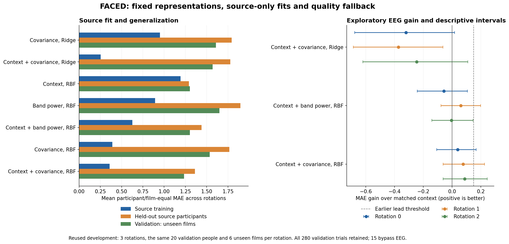

# FACED representation and source learning-capacity findings

Completed: 11 October 2026. **The bounded experiment and independent numerical audit are finished. A richer EEG representation can nearly memorize real and shuffled source ratings, but its held-out prediction does not meet the declared lead threshold. No larger encoder study or paper pivot is justified by this experiment.** The manuscript and research question remain unchanged; all confirmation participants and film families remain sealed.

The [completed packet](../../results/development/faced_representation_v2_2026-10-11/README.md), [full comparisons](../../results/development/faced_representation_v2_2026-10-11/comparison.json), [36,120 predictions](../../results/development/faced_representation_v2_2026-10-11/predictions.csv) and [independent audit](../../results/development/faced_representation_v2_2026-10-11/independent_analysis/summary.json) preserve the results. All previously completed experiments and the initial failed preparation are retained.

## What was declared and run

The [scientific protocol](FACED_Representation_Capacity_Protocol_2026-10-11.md) was pushed before new signal preparation as [bb9e104c1](https://github.com/Overproness/GRU-XNet_EEG_Emotion_Recognition/commit/bb9e104c1). It reuses the exact three development rotations, seventy source participants, twenty validation participants, fourteen development clips and five source participant folds. The same people and overlapping films recur across rotations; these are reused development panels, not independent replications.

The single new representation captures electrode relationships using five band covariance matrices from the existing seven Hann/detrended EEG windows. Each matrix is trace-normalized, shrunk 10% toward the identity and mapped through the symmetric matrix logarithm. Upper-triangle coordinates with sqrt(2) off-diagonal weights plus five log total-power values give 2,330 features. The existing 150 log band-power features remain the reference. Covariance/manifold EEG representations are established; this trial-local log-Euclidean variant is a diagnostic, not a new algorithm or exact reproduction of an affine-invariant method. [Established representation work](https://arxiv.org/abs/2008.08633), [pyRiemann documentation](https://pyriemann.readthedocs.io/en/latest/generated/pyriemann.tangentspace.TangentSpace.html).

Seven fixed conditions combine covariance, the existing spectral features and context with linear Ridge or a Gaussian RBF kernel readout. Linear covariance uses alpha 1,000 alone and 100 with context, matching the preceding EEG/joint regularizations. Kernel conditions use fixed alpha 0.1. All source scalers, per-block weighting, source-median distance bandwidths and target offsets are refitted within each exact source fold. There is no new validation-dependent hyperparameter selection. Kernel Ridge is an established nonlinear regression method. [Official documentation](https://scikit-learn.org/stable/modules/generated/sklearn.kernel_ridge.KernelRidge.html).

Each condition has one main fit and five held-source-participant fits per rotation: 126 normal fits. Twelve additional source-only capacity fits use kernel alpha 1e-6 with real or shuffled source targets, with the same permutation across representations in each rotation. Total **138 new closed-form CPU fits**, no neural/GPU fits. The completed run takes **648.4 seconds**, within its two-hour cap. All outputs from every condition are retained; no winning condition triggers another fit.

All 980 source trials pass current quality and reproduce the preceding count/window/access/reference-feature bytes. Only 265 available validation EEG trials are prepared; the fifteen unavailable trials bypass original EEG and feature reads and retain the fixed fallback branches. All 280 validation outcomes and twenty people remain in evaluation. Joint linear fallback uses the preceding selected source-fitted context Ridge; joint nonlinear fallback uses the matched fixed context kernel. EEG-only fallback uses the exact source global median. There are 270 fallback prediction rows across the EEG-dependent models and rotations.

The successful run independently scalar-checks 812.16 million selected original count values. It decodes zero new original ratings, other rating items, protected/neighbor EEG values or confirmation outcomes. It reuses exactly 1,260 already authorized published development targets after the persisted source gate. Waveforms, feature arrays and model states remain private; anonymous predictions and technical evidence are public under the author's standing authorization.

## Source fitting and generalization

Numbers below are participant/film-equal MAE for continuous individual valence on the original 0–7 scale, averaged across the three rotations. Lower is better. These errors do not describe the historical pooled binary accuracy.

| Fixed condition | Source training | Held-out source participants | Validation, unseen films | Validation, familiar films |
| --- | ---: | ---: | ---: | ---: |
| Covariance, Ridge | 0.952 | 1.795 | 1.608 | 1.759 |
| Context + covariance, Ridge | 0.255 | 1.778 | 1.570 | 1.707 |
| Context, RBF | 1.192 | 1.291 | 1.302 | 1.186 |
| Band power, RBF | 0.893 | 1.897 | 1.650 | 1.748 |
| Context + band power, RBF | 0.626 | 1.439 | 1.302 | 1.257 |
| Covariance, RBF | 0.392 | 1.767 | 1.536 | 1.688 |
| Context + covariance, RBF | 0.358 | 1.363 | 1.234 | 1.190 |

Adding EEG lowers source training error markedly but increases held-source-participant error relative to the matched context readout. For example, covariance plus context with Ridge has training MAE 0.255 and source OOF MAE 1.778. Its nonlinear counterpart has training MAE 0.358 and source OOF MAE 1.363, compared with 1.291 for context kernel alone. This is a substantial source-to-held-participant generalization gap under the declared representations and budgets.

The original quality-policy context Ridge has mean unseen-film MAE **1.25771**; the preceding spectral-plus-context Ridge remains at **1.21555**. The new covariance-plus-context kernel is **1.23392**, so its improvement over matched kernel context cannot be presented as beating the preceding spectral joint control.

| Joint condition | Mean gain over matched context | Mean gain over original context Ridge | Mean gain over fixed strongest source prior | Positive matched-gain rotations | Declared screen |
| --- | ---: | ---: | ---: | ---: | --- |
| Covariance, Ridge | -0.31220 | -0.31220 | -0.30974 | 0/3 | Not met |
| Band power, RBF | -0.00004 | -0.04409 | -0.04163 | 1/3 | Not met |
| Covariance, RBF | 0.06784 | 0.02379 | 0.02626 | 3/3 | Not met |

The kernel context baseline is weaker than the original context Ridge on unseen films. Report both comparisons. The covariance-kernel matched gains are 0.03884, 0.07731 and 0.08737; their descriptive crossed-bootstrap intervals are respectively [-0.10636, 0.16808], [-0.06166, 0.22550] and [-0.06227, 0.24491]. All three include zero. The larger average gain over this weaker matched baseline still falls below the preexisting **0.15** engineering threshold, and its gain over original context Ridge is smaller.

Intervals use the original 4,000 participant/film draws and seed. Only six unseen films and the same twenty validation people are present per rotation. New heads were fixed before execution, but earlier development outcomes and baseline-selected alphas were already examined. These are descriptive exploratory intervals, not independent confirmation or tuning-corrected inference. Linear covariance joint prediction is worse in every rotation; one descriptive interval excludes zero in the negative direction. The full packet also retains familiar-film, acquisition-group and leave-film results.

The standalone PNG/SVG figure was visually checked. Its [coordinates](../../results/development/faced_representation_v2_2026-10-11/figures/coordinates.json) bind twenty-one mean-error coordinates and nine gain intervals to the comparison receipt.

## What the capacity controls establish

At alpha 1e-6, mean raw source MAE is **0.00003747** for real band-power targets and **0.00004558** for shuffled targets. Corresponding covariance errors are **0.00000548** and **0.00000653**. Each fitted source vector is nearly interpolated, including arbitrary shuffled assignments. Permutations are source-only, identically seeded across representations, and never evaluated on validation.

This establishes that these readouts and input vectors can fit the source assignments. It does not establish emotion information or useful generalization. Near-zero training error is expected to be possible for a flexible kernel; its agreement with shuffled targets makes the limitation explicit. The independently checked maximum equation residual is 1.78e-12, so unfinished iterative optimization does not explain these particular closed-form fits. This does not demonstrate that every neural encoder has been optimized or that EEG contains no emotion information.

## Preserved preparation hold and numerical corrections

The first frozen attempt stopped at sub-085/clip-25 after 655 source trials because exact processed-window bytes changed under a global two-thread cap. It produced **zero validation trials, fits or predictions**. Its [failure receipt](../../results/development/faced_representation_2026-10-11/execution.json) and partial caches remain intact and contribute no fitted result to the tables.

A separately frozen [eight-trial source diagnosis](../../results/development/faced_representation_2026-10-11/replay_diagnosis/comparison.json) decodes 4.08 million selected count values, with zero targets/validation/fitting. Default threading reproduces all eight prior repaired window hashes; capped-two changes two trials by up to 7.63e-6 microvolts. Using prior literal spline coefficients under capped-two does not reproduce all eight either. Detection choices remain unchanged. The [fresh continuation](FACED_Representation_Continuation_2026-10-11.md) restores twelve BLAS threads only for original preprocessing, keeps readout/covariance work at two threads, and restarts source preparation into a separate directory. It was pushed as [79804a245](https://github.com/Overproness/GRU-XNet_EEG_Emotion_Recognition/commit/79804a245) before new original-data execution. Exact byte checks remain mandatory; all scientific conditions and thresholds are unchanged.

A separately recorded [auditor supplement](FACED_Representation_Audit_Supplement_2026-10-11.md) corrects only the independent checker's treatment of exact duplicate context rows in norm-expanded distances. The fitting implementation already uses direct pair differences correctly. The original auditor remains preserved, and the corrected checker is bound before fitted outcomes. Neither correction selects a representation, threshold or model from better validation scores.

## Verification, contribution decision and next step

**111 focused tests pass**, including source/validation access guards, unavailable-EEG callback bypass, independently checked covariance/Welch diagonals and matrix logarithms, readout agreement with established estimators, exclusion invariance, duplicate-distance handling and thread restoration after success/failure.

The independent script verifies **1,245 representations, 138 exact source-fit states, 36,120 predictions, 270 fallback rows and 3,873 private evidence files**, without calling the new feature/fit/quality/prediction functions or reopening original data. It independently reconstructs source means/variances/scales, bandwidths, offsets, source permutations and linear-system equations; reproduces all saved-state predictions and fallback values; and checks every metric, descriptive interval and lead decision. Maximum feature discrepancy is 1.07e-13, maximum prediction discrepancy 2.05e-12 and metric discrepancy zero. [Verification receipt](../../results/development/faced_representation_v2_2026-10-11/independent_analysis/verification.json).

**This completes the requested bounded representation/capacity experiment. There is no qualifying lead for automatic encoder-grid expansion or independent confirmation.** It supports distinguishing source memorization from held-out usefulness, rather than treating low training error or a weak context comparator as a publication contribution. Strong conference readiness, closest-method novelty, independent confirmation, physical stimulus timing/media/pretraining-overlap authentication and author processed-data provenance remain unresolved at their previous scopes. The DEAP first-party and EmoEEG-MC codebook dependencies also remain open.

The next useful step is an evidence-backed contribution and dataset/target decision using the accumulated studies before another fitting programme. An evaluation-focused paper is an option to assess: it would need a precise claim, matched strong baselines, clear target/context semantics, closest-work comparison and a locked independent confirmation plan. These development findings alone are insufficient to adopt that direction. A model-centered alternative would need positive held-out evidence, not another capacity demonstration. Keep the existing encoder-expansion hold and all confirmation seals. Present any concrete alternative research-question proposal for the author's explicit approval and preserve a fresh manuscript archive before adoption; **no such adoption or further fitting is launched by this decision**.
