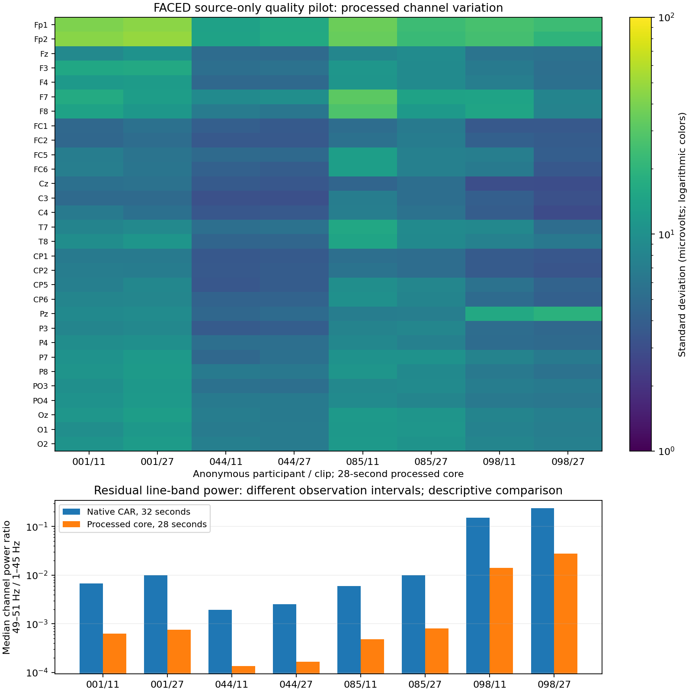

# FACED source-only decoder and signal-quality pilot

11 October 2026. The requested eight-trial technical pilot is complete. All eight declared source trials decode and calibrate consistently and produce the proposed seven-window geometry. A channel-level review exposed substantial residual line-band power in one participant; a separately declared, fixed notch control addressed it on the same trials. All individual ratings remain sealed. No supervised access, model fitting, confirmation evaluation or manuscript-question change occurred.

The [design proposal](GRU-XNet_FACED_Design_Proposal_2026-10-11.md) remains preserved. Evidence is in the [source-quality packet](../../results/development/faced_source_quality_2026-10-11/README.md), with [per-channel records](../../results/development/faced_source_quality_2026-10-11/records.json), [trial table](../../results/development/faced_source_quality_2026-10-11/trial_quality.csv) and [notch-control records](../../results/development/faced_source_quality_2026-10-11/line_noise_records.json).

## Scope and source protection

The fixed participants are sub-001, sub-044, sub-085 and sub-098; clips are 11 and 27. All four participants and both film families belong to the proposed primary source role. They cover legacy 1000-Hz, legacy 250-Hz and modern 1000-Hz acquisitions. This is a small technical feasibility sample, not population-level signal-quality assessment.

The execution declaration was committed as [6eafcec8e](https://github.com/Overproness/GRU-XNet_EEG_Emotion_Recognition/commit/6eafcec8e) before real sample access. The original data-file headers and complete files were rehashed against the prior extraction/lineage receipts; marker and behavioral companions were hashed as opaque bytes only. Hashing did not numerically interpret behavioral contents. The selective reader sought only 30 scalp channels and the declared 32 seconds ending at or before each video's original end marker. It skipped auxiliary channels, partial boundary-record neighbors and every other trial. Private access ledgers record every byte range; public receipts preserve their hashes and accounting. Original files were rehashed after access.

Exactly **6,240,000 original sample values** were decoded, each checked against an independent scalar signed-byte conversion. These eight intervals were decoded a second time for the fixed line-noise control, with identical identity/sample-range ledgers: 12,480,000 total numerical interpretations of 6,240,000 distinct original samples. No extra participant, material, auxiliary-channel or neighbor-trial sample was decoded.

The selective reader follows the channel-block record layout of the [BioSemi BDF specification](https://www.biosemi.com/faq/file_format.htm). Before real access, manufactured signed-endpoint and partial-record bytes were independently read using [PyEDFlib 0.1.42](https://pyedflib.readthedocs.io/en/latest/ref/edfreader.html): all 14 selected digital values and physical values agreed. This external-library comparison used manufactured data, not original recordings. The real samples' physical conversion also agreed with a separately expressed gain/offset formula to within **3.64 × 10⁻¹¹ microvolts**, consistent with the [EDF calibration definition](https://www.edfplus.info/specs/guidelines.html). These checks support file interpretation; they do not establish instrument calibration against a physical reference.

## Original fixed preprocessing and quality findings

The original proposal uses the qualified 30-channel ordering, sample-wise common average, native-rate 0.5–45 Hz Butterworth SOS forward/backward filtering, 128-Hz polyphase resampling and a 28-second end-relative core. Each trial produces **7 × 30 × 512**, giving 56 retained windows across eight trials. No fitted normalizer, interpolation, ICA, trial rejection or window rejection was introduced.

| Participant | Clip | Native Hz | Processed channel SD min / median / max, µV |
| --- | --- | --- | --- |
| 001 | 11 | 1000 | 4.62 / 9.23 / 43.86 |
| 001 | 27 | 1000 | 4.95 / 10.14 / 48.60 |
| 044 | 11 | 250 | 3.13 / 4.83 / 14.27 |
| 044 | 27 | 250 | 3.08 / 4.95 / 16.29 |
| 085 | 11 | 1000 | 4.48 / 10.24 / 35.69 |
| 085 | 27 | 1000 | 5.16 / 8.65 / 23.60 |
| 098 | 11 | 1000 | 3.03 / 6.53 / 26.35 |
| 098 | 27 | 1000 | 2.89 / 5.41 / 23.38 |

No channel hit an ADC rail. All outputs were finite; the common-average residual was below 7.24 × 10⁻⁷ µV. No channel met the predefined stationary-count, low/high processed-variation or extreme-excursion flags. These are engineering flags, not validated artifact detectors. The original flags did not include line-band dominance, so passing them did not qualify artifact freedom.

Raw absolute channel-median offsets have trial-level medians of approximately **3,509–16,832 µV**. Those values remain consistent with the stored header conversion, but their physical origin is unverified. Filtering removes stationary offsets from the evaluated core; large raw offsets must not be mistaken for band-limited cerebral activity. Fp1/Fp2 have the largest processed variation in these trials. Without artifact identification, this pattern cannot distinguish neural activity from ocular or other contamination.

Channel inspection found a specific additional problem: **Pz in sub-098** has native 49–51 / 1–45 Hz power ratios around 126–143, with a 50-Hz spectral peak. After the original processing, its ratios remain **11.34 and 18.49**. The overall median ratios hid this single-channel problem. A 45-Hz band edge gives finite attenuation rather than a complete 50-Hz rejection, so the original pipeline should not enter supervised development without resolving this observation.

The overview compares the native 32-second segment with the processed 28-second core. Those ratios are descriptive and are not an empirical filter transfer function.

## Separately declared fixed line-noise control

The original records, thresholds and proposal were preserved. Before further access, [a543cfd1f](https://github.com/Overproness/GRU-XNet_EEG_Emotion_Recognition/commit/a543cfd1f) recorded the original results, the [follow-up declaration](../../results/development/faced_source_quality_2026-10-11/line_noise_plan.json) and its execution clarification. This follow-up was motivated by observed source EEG; it was not an original preregistered quality criterion or a confirmation result.

One fixed control applies `iirnotch(50, Q=30, fs=native_rate)` forward/backward inside the same trial-local 32 seconds, followed by the unchanged proposed pipeline. No center-frequency, Q, channel-removal or filter-order search was performed. [SciPy's notch definition](https://docs.scipy.org/doc/scipy/reference/generated/scipy.signal.iirnotch.html) specifies this narrow-band filter and its quality factor. The installed runtime remains Python 3.11.13, NumPy 2.4.4 and SciPy 1.17.1.

| sub-098 Pz trial | Original processed 49–51 / 1–45 ratio | Fixed-notch processed ratio |
| --- | --- | --- |
| Clip 11 | 11.341985 | 0.00005047 |
| Clip 27 | 18.493362 | 0.00011558 |

All eight trials meet the separately declared follow-up checks: every notched channel has a ratio below 0.10, no original engineering flag newly appears, and per-channel 1–30 Hz power changes stay within the fixed 5% limit. The **largest measured 1–30 Hz change is 0.151%**; the largest notched line ratio across all 240 channels is **0.00038645**. Before/after control comparisons use the same 28-second core. This supports a fixed source-informed notch addition, without establishing universal artifact removal, preservation of every EEG feature or emotion information.

Every original QC aggregate replayed exactly. The initial pilot did not retain arrays or publish their byte hashes; the execution clarification records that historical array-hash comparison is unavailable. The control publishes first-time fingerprints of its recomputed baseline and notch arrays, not a claim of historical byte-hash replay. Sample arrays themselves remain unexported.

## What this completes and what remains

**Completed:** selective numerical decoding, file/calibration/boundary checks and fixed-pipeline feasibility for the eight declared trials; source-only identification and bounded correction of an observed 50-Hz problem; all 56 windows retained. Twenty-four focused tests passed before the pilot, and three notch-behavior tests passed before its follow-up. Local access-ledger replay and portable public evidence checks pass.

**Still unresolved:** full-source recording quality, individual item-10 vector geometry and selective rating access, learning capacity, context-versus-EEG benefit, generalization to held films/people, independent physical timing alignment, stimulus-version/content authentication and closest-method novelty. No affected `?V` participant was selected; that unit interpretation remains supported by earlier lineage and synthetic checks rather than this real-sample pilot. Eye/muscle/motion artifacts were not identified or removed. Existing DEAP authentication and the outstanding EmoEEG-MC author codebook are separate concerns.

**Recommended next phase:** preserve the original candidate and issue a separate source-informed development declaration that includes the fixed 50-Hz notch. First verify item-10 storage geometry and a selective decoder using manufactured behavioral structs, with explicit participant/material/item guards. Only then open the declared source/validation rating rows for bounded context and spectral controls; leave all confirmation participants and confirmation films sealed. Broader source QC must retain every trial and declared fallback/coverage handling. Do not start a neural grid before target/schema and source-learning checks pass.

The current manuscript and historical archive are unchanged. A new paper question still needs an evidence-backed proposal, the author's explicit approval and a fresh archive immediately before revision. This pilot supplies preprocessing evidence, not a publishable model-performance or novelty claim.
